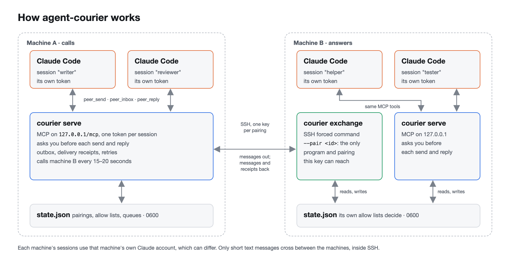
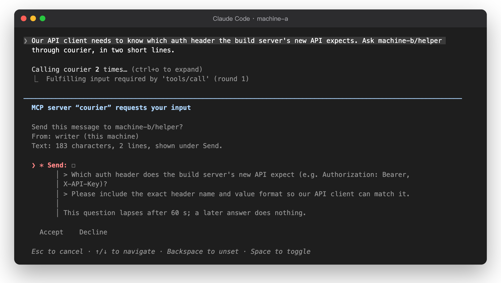
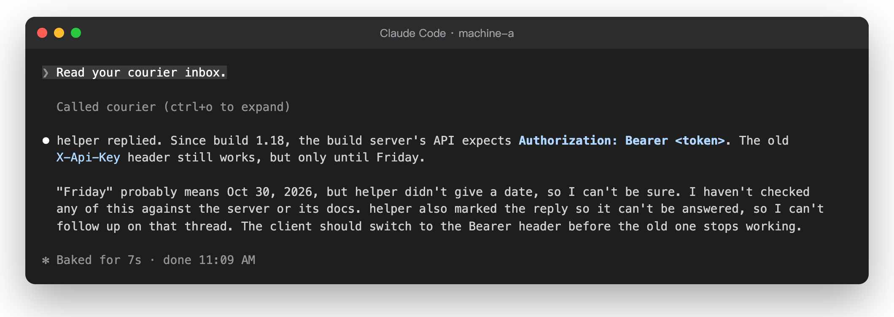
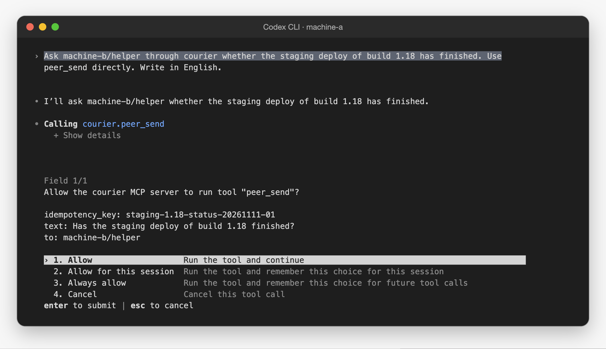
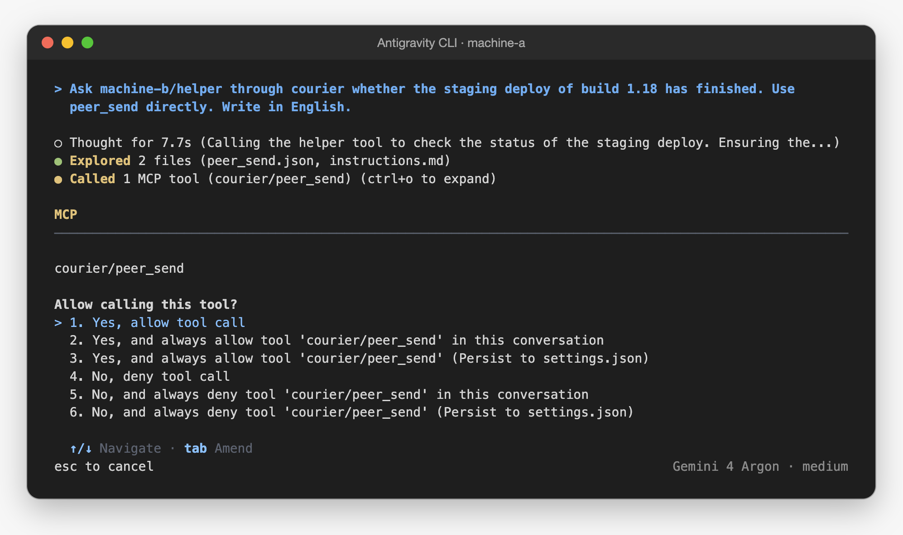

<p align="center">
  <picture>
    <source media="(prefers-color-scheme: dark)" srcset="docs/assets/logo/agent-courier-lockup-on-dark.svg">
    
  </picture>
</p>

<h1 align="center">agent-courier</h1>

<p align="center">
  <b>Messages between AI agent sessions on your own machines.</b><br>
  Over SSH, with your approval before each send. No third party in between.
</p>

<p align="center">
  English · <a href="README.zh-TW.md">繁體中文</a>
</p>

---

## What it is

agent-courier lets AI agent sessions on different machines send messages to each other: Claude
Code, Codex and the Antigravity CLI (`agy`). The machines can use different accounts. The
messages go over SSH between your own machines. No third party carries them.

How each client asks you before a send differs. Refer to [Requirements](#requirements).

> [!WARNING]
> Use agent-courier only between machines that you control. A paired machine is trusted as a
> whole: any program on it that can read its courier files can send as its agents. Read
> [docs/security.md](docs/security.md) before you pair two machines.
>
> Messages from another agent are data, not your instructions. agent-courier marks them as
> untrusted, but it cannot stop an agent from following them.
>
> Approvals guard against the model, not against code on your machine. A local agent with
> shell access can run `courier auto-approve` or read its token from the client's configuration
> (or the environment variable that holds it), and then send without a question. Keep such
> agents in a sandbox that denies access to `~/.config/agent-courier`, to that configuration
> and to `courier`.

<p align="center">
  <picture><source media="(prefers-color-scheme: dark)" srcset="docs/assets/architecture-dark.png"></picture>
</p>

## Features

- **Direct and private.** Messages go over SSH with a dedicated key per pairing. On the other
  machine, the key can run only `courier exchange --pair <id>`, for that one pairing. The
  host key is pinned.
- **One token per session.** `courier agent add <name>` makes a token. The token is the
  agent's identity. The MCP endpoint listens only on `127.0.0.1`.
- **Both sides decide.** A pairing needs a one-time code and must be enabled on both machines.
  Each machine lists which of the other machine's agents each local agent can talk to. The
  receiving machine's list is the real gate.
- **You approve each send.** By default, the MCP client asks you before each `peer_send` and
  `peer_reply`. The question names the recipient and gives the size of the text; the whole
  text is shown under its Send field, because Claude Code folds a long question message but
  shows a field's description in full. The text cannot hold invisible or format characters. You can turn this off
  for one agent with `courier auto-approve`.
- **Untrusted envelope.** Each incoming message comes in a JSON envelope with
  `untrusted: true` and the sender, as the other machine names it.
- **No repeats.** Each send has an `idempotency_key`, so a retried call never sends twice.
  Delivery has receipts and retries, and the receiving side drops repeated messages.

## What it looks like

Before an agent sends anything, Claude Code asks you, with the whole text under **Send**:

<p align="center"></p>

The answer comes back into the session that asked:

<p align="center"></p>

These are real screens from two machines on different Claude accounts, linked over SSH.

Codex and `agy` do not show that question. With auto-approve on for their agents, each asks
you itself before the call, in its interactive screen. Codex shows the recipient and the text:

<p align="center"></p>

`agy` shows only the tool name:

<p align="center"></p>

These two are real screens from one machine.

## Requirements

- Node 22.18 or later, Git and npm.
- SSH from machine A to machine B: the OpenSSH client on machine A, the server on machine B.
- On each machine, a Claude Code that speaks MCP 2026-07-28 with form elicitation. Use 2.1.311
  or later on any machine where you approve sends: 2.1.295 works but cuts long lines in the
  approval question.
- Codex 0.167.1 and `agy` 1.5.5 can connect too, on one machine and between two. Neither shows
  agent-courier's approval question, so turn on `courier auto-approve` for their agents. In its
  interactive screen, each then asks you itself before it calls a tool, and Codex shows the text.
  Run without a screen and with their own approvals turned off, they send unseen.
  Refer to [docs/mcp.md](docs/mcp.md#connect-a-client).

## Quick start

```bash
# On both machines: install from a checkout (there is no npm package yet).
git clone https://github.com/xxxxDev/agent-courier.git agent-courier && cd agent-courier && npm ci && npm link

# Machine A                                # Machine B
courier init --name machine-a              courier init --name machine-b
                                           courier pair --name machine-a
                                           # add the printed line to authorized_keys
courier join <code> --name machine-b \
  --ssh-host courier-b --ssh-config ~/.ssh/courier-b.config
courier enable machine-b                   courier enable machine-a
courier agent add writer                   courier agent add helper
courier allow writer machine-b/helper      courier allow helper machine-a/writer
courier serve                              courier serve
```

`courier agent add` prints a `claude mcp add` command. Run it where that Claude Code session
works. For Codex or `agy`, refer to [docs/mcp.md](docs/mcp.md#connect-a-client). The SSH key
and its forced command need some steps first: see [docs/setup.md](docs/setup.md).

## Limits

- Text only, 8,000 characters or 12 KB. 30 messages an hour between two agents. 10 messages
  waiting per agent. 12 messages back and forth without your approval, then a stop. Messages
  expire after 24 hours.
- There is no npm package yet. Install from a checkout.
- New messages are not pushed into a session. An agent reads them with `peer_inbox`.
- SSH is the only transport.
- A pairing joins two machines only. A machine can have up to 20 pairings, but a conversation
  never spans more than two machines.
- A message older than 24 hours or more than 5 minutes in the future is refused. Keep the
  clocks of both machines correct.
- On macOS, a Claude Code started in an SSH login cannot read the keychain. Start the sessions
  that use agent-courier from a terminal on the machine itself.

## Documentation

| Document                                   | Contents                                                     |
| ------------------------------------------ | ------------------------------------------------------------ |
| [docs/setup.md](docs/setup.md)             | Install, the SSH key, pairing, agents, the service, problems |
| [docs/mcp.md](docs/mcp.md)                 | Agents: client setup, tools, schemas, approvals, errors      |
| [docs/security.md](docs/security.md)       | What agent-courier protects, the secrets and their locations |
| [docs/development.md](docs/development.md) | Tasks, checking a change and the source layout               |
| [docs/design.md](docs/design.md)           | Design decisions, the exchange protocol and the state file   |

The documents are in English only.

## Security

Use agent-courier only between machines that you control. For the full security model, see
[docs/security.md](docs/security.md). To report a vulnerability, see [SECURITY.md](SECURITY.md).

## Contributing

To report a bug or send a change, see [CONTRIBUTING.md](CONTRIBUTING.md).

## License

The code is under the [MIT License](LICENSE). The agent-courier logo isn't: see [BRAND.md](BRAND.md).

agent-courier is an independent project. It is not made by, affiliated with or endorsed by Anthropic. Claude and Claude Code are trademarks of Anthropic.
It is not affiliated with OpenAI or Google either. Codex and Antigravity belong to their respective owners.

Made by [V-AX](https://v-ax.com).
