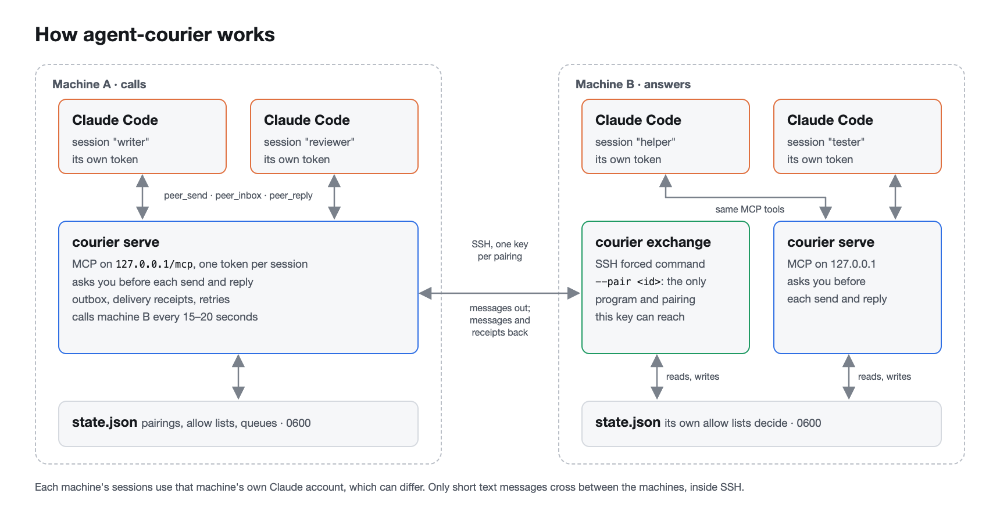
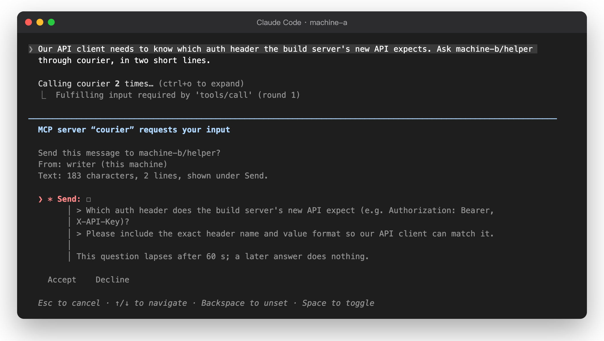
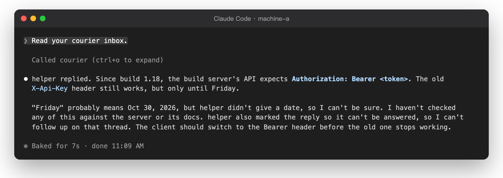

<p align="center">
  <picture>
    <source media="(prefers-color-scheme: dark)" srcset="docs/assets/logo/agent-courier-lockup-on-dark.svg">
    
  </picture>
</p>

<p align="center"><a href="README.md">English</a> · 繁體中文</p>

# agent-courier

agent-courier 讓不同機器上的 Claude Code 工作階段互相傳訊息。各台機器可以用不同的 Claude 帳號。訊息走你自己機器之間的 SSH，不經過任何第三方。

> [!WARNING]
> 只在你自己掌控的機器之間使用 agent-courier。配對的機器會被整台信任：上面任何能讀到 courier 檔案的程式，都能以它的 agent 身分傳訊息。配對兩台機器之前，請先讀 [docs/security.md](docs/security.md)。
>
> 另一個 agent 傳來的訊息是資料，不是你的指示。agent-courier 會把它標成不可信，但無法阻止 agent 照著做。
>
> 確認步驟防的是模型，不是你機器上的程式。能用 shell 的本機 agent 可以執行 `courier auto-approve`，或從 Claude Code 的設定讀出它的 token，然後不經詢問就傳訊息。這類 agent 請放在沙盒裡，禁止它存取 `~/.config/agent-courier`、Claude Code 的設定和 `courier`。

<p align="center">
  <picture><source media="(prefers-color-scheme: dark)" srcset="docs/assets/architecture-dark.png"></picture>
</p>

## 功能

- **直接又私密。** 訊息走 SSH，每組配對用一把專用金鑰。在對方機器上，這把金鑰只能執行那一組配對的 `courier exchange --pair <id>`。主機金鑰會被釘選。
- **每個工作階段一個 token。** `courier agent add <name>` 會產生 token，token 就是 agent 的身分。MCP 端點只聽 `127.0.0.1`。
- **兩邊都要同意。** 配對需要一次性代碼，而且兩台機器都要啟用。每台機器各自列出本機每個 agent 可以和對方哪些 agent 對話；收訊那一台的清單才是真正的關卡。
- **每次傳送都由你確認。** 預設在每次 `peer_send` 和 `peer_reply` 之前，MCP 用戶端都會問你。問題會寫明收件者和文字長度，全文放在「Send」欄位底下；因為 Claude Code 會摺疊過長的問題，但欄位說明會完整顯示。文字不能含有看不見的字元或格式字元。可以用 `courier auto-approve` 對單一 agent 關閉確認。
- **不可信的信封。** 每則收到的訊息都包在 JSON 信封裡，帶有 `untrusted: true`，以及對方機器所稱的寄件者。
- **限制。** 只能傳文字，最多 8,000 個字元或 12 KB。兩個 agent 之間每小時 30 則。每個 agent 最多 10 則等待中的訊息。未經你確認最多來回 12 則，之後就停下。訊息 24 小時後過期。
- **不會重複。** 每次傳送都有 `idempotency_key`，重試的呼叫不會送兩次。投遞有回條和重試，收訊端會丟掉重複的訊息。

## 實際畫面

agent 傳送任何東西之前，Claude Code 會先問你，全文放在 **Send** 底下：

<p align="center"></p>

回覆會回到發問的那個工作階段：

<p align="center"></p>

這些是兩台用不同 Claude 帳號、以 SSH 連線的機器上的真實畫面。

## 快速開始

你需要 Node 22.18 以上、Git、從機器 A 到機器 B 的 SSH，以及每台機器上支援 MCP 2026-07-28 和表單詢問（form elicitation）的 Claude Code。要在哪台機器上確認傳送，那台就用 2.1.311 以上：2.1.295 也能用，但確認問題裡的長行會被截斷。

```bash
# 兩台機器都要：從原始碼安裝（目前還沒有 npm 套件）。
git clone https://github.com/xxxxDev/agent-courier.git agent-courier && cd agent-courier && npm ci && npm link

# 機器 A                                    # 機器 B
courier init --name machine-a              courier init --name machine-b
                                           courier pair --name machine-a
                                           # 把印出的那一行加進 authorized_keys
courier join <code> --name machine-b \
  --ssh-host courier-b --ssh-config ~/.ssh/courier-b.config
courier enable machine-b                   courier enable machine-a
courier agent add writer                   courier agent add helper
courier allow writer machine-b/helper      courier allow helper machine-a/writer
courier serve                              courier serve
```

`courier agent add` 會印出一行 `claude mcp add` 指令，在那個 Claude Code 工作階段所在的地方執行它。SSH 金鑰和它的強制指令需要先做幾個步驟，請看 [docs/setup.md](docs/setup.md)。

| 文件                                       | 內容                                         |
| ------------------------------------------ | -------------------------------------------- |
| [docs/setup.md](docs/setup.md)             | 安裝、SSH 金鑰、配對、agent、服務、疑難排解  |
| [docs/mcp.md](docs/mcp.md)                 | agent 端：用戶端設定、工具、結構、確認、錯誤 |
| [docs/security.md](docs/security.md)       | agent-courier 保護什麼、機密和它們的位置     |
| [docs/development.md](docs/development.md) | 工作指令、檢查改動、原始碼結構               |
| [docs/design.md](docs/design.md)           | 設計決策、交換協定、狀態檔                   |

文件目前只有英文。

## 開發

```bash
mise run check   # prettier、tsc 和 oxlint
```

## 授權

MIT，請看 [LICENSE](LICENSE)。

agent-courier 的標誌（本頁與 `docs/assets/logo/`）屬於 [V-AX](https://v-ax.com)，**不在** MIT 授權範圍內，請看 [BRAND.md](BRAND.md)。
